**DOSSIER D’ARCHITECTURE TECHNIQUE**

**Infrastructure virtuelle de production simulée**

| **Référence** | ARC INFRA 001                                                     |
|---------------|-------------------------------------------------------------------|
| **Version**   | 1.6                                                               |
| **Statut**    | Référence technique                                               |
| **Date**      | Octobre 2026                                                      |
| **Auteur**    | Richard Lamah                                                     |
| **Périmètre** | 11 machines virtuelles, réseau, sécurité, services et supervision |

*Document de référence destiné à la compréhension, à l’exploitation et à la maintenance de l’infrastructure.*

> **Positionnement documentaire**
>
> La documentation décrit l’état de référence de l’environnement à la date du 02 octobre 2026. Les paramètres non fournis sont identifiés comme éléments à confirmer et ne sont pas présentés comme des faits.

# Sommaire

1. Objet et périmètre

2. Architecture générale

3. Topologie réseau et adressage

4. Inventaire des machines et services

5. Services d’infrastructure

6. Supervision Zabbix

7. Haute disponibilité pfSense

8. Politique réseau et sécurité

9. Flux applicatifs et dépendances

10. Exploitation et procédures

11. Plan de validation

12. Continuité, sauvegarde et restauration

13. Risques et évolutions

14. Annexes

> **Lecture du document**
>
> Le dossier commence par la vue d’ensemble, puis descend vers le détail des réseaux, des serveurs, des services, de la sécurité et des opérations. La partie validation permet de reproduire les contrôles lors d’une recette ou d’un entretien technique.

# 1. Objet et périmètre

Le présent dossier décrit une infrastructure informatique virtualisée conçue pour reproduire un petit système d’information d’entreprise dans un environnement de production simulée. L’objectif est de disposer d’une base exploitable pour l’administration système, le réseau, la sécurité, la supervision et les opérations de continuité de service.

## 1.1 Périmètre technique

- Couche de pare-feu assurée par deux machines pfSense disposant chacune d’une interface WAN, d’une interface LAN et d’une interface de synchronisation.

- Réseau interne unique porté par VMnet14 avec le plan 192.168.99.0/24.

- Réseau de synchronisation dédié porté par VMnet15 avec le plan 10.1.10.0/24.

- Services Windows avec Active Directory et DNS sur Windows Server 2019.

- Quatre postes Windows membres du domaine ecole-gn.gn.

- Serveur Debian 13 pour Zabbix Server et sa base MariaDB.

- Serveur Ubuntu 24.04 pour WordPress, Nginx, MariaDB et agent Zabbix.

- Poste Kali Linux pour les contrôles de sécurité et agent Zabbix.

- Poste Ubuntu Client pour les usages Linux et les tests fonctionnels.

## 1.2 Principes d’architecture

- Une seule passerelle logique est présentée aux équipements du LAN : 192.168.99.100.

- Le trafic Internet passe par la paire pfSense et le réseau WAN 192.168.112.0/24.

- La synchronisation entre les deux pare-feu passe par un réseau isolé de production, VMnet15.

- Les adresses 192.168.99.110 à 192.168.99.120 restent joignables sur le réseau interne mais ne disposent pas de sortie Internet.

- Le service de résolution de noms du domaine est assuré par Windows Server 2019 à l’adresse 192.168.99.15.

# 2. Architecture générale

Le chemin principal de communication est structuré autour de deux plans réseau distincts. Le premier porte les flux utilisateurs et serveurs. Le second est réservé à la synchronisation de la paire pfSense. Les deux pare-feu partagent la même sortie WAN et exposent une adresse virtuelle unique côté LAN.

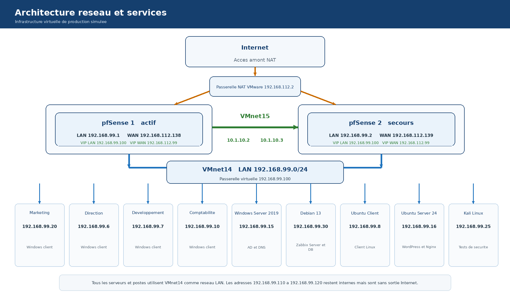

*Figure 1. Architecture logique : WAN, paire pfSense HA, réseau de synchronisation VMnet15 et LAN VMnet14.*

## 2.1 Vue par zone

| **Zone**        | **Réseau**       | **Équipements**                          | **Usage**                                       |
|-----------------|------------------|------------------------------------------|-------------------------------------------------|
| Accès amont     | 192.168.112.0/24 | Deux interfaces WAN pfSense et la VIP WAN 192.168.112.99 | Accès Internet par la passerelle NAT VMware 192.168.112.2 |
| LAN             | 192.168.99.0/24  | Deux LAN pfSense et toutes les autres VM | Services internes, postes, administration       |
| Synchronisation | 10.1.10.0/24     | pfSense 1 et pfSense 2                   | Synchronisation de la paire HA                  |

## 2.2 Point de raccordement logique

Le réseau VMnet14 constitue le domaine de niveau deux communs aux postes, aux serveurs et aux deux interfaces LAN pfSense. Les machines adressées dans 192.168.99.0/24 utilisent 192.168.99.100 comme passerelle. Les deux adresses 192.168.99.1 et 192.168.99.2 identifient les interfaces LAN physiques des membres de la paire.

> **Point d’attention**
>
> La paire pfSense ne doit pas être documentée comme deux passerelles indépendantes côté utilisateurs. La valeur de référence fournie par la conception est la VIP 192.168.99.100.

# 3. Topologie réseau et adressage

## 3.1 Réseaux

| **Réseau**      | **Segment VMware** | **Plan**         | **Rôle**                | **Passerelle** |
|-----------------|--------------------|------------------|-------------------------|----------------|
| LAN             | VMnet14            | 192.168.99.0/24  | Production interne      | 192.168.99.100 |
| Synchronisation | VMnet15            | 10.1.10.0/24     | Synchronisation pfSense | Aucune         |
| WAN             | NAT VMware         | 192.168.112.0/24 | Sortie Internet         | 192.168.112.2 (NAT VMware) |

*Le masque /24 du WAN est confirmé par la console de pfSense. L’adresse 192.168.112.99 n’est pas la passerelle amont : c’est la VIP CARP WAN (VHID 1) partagée par la paire pfSense. La passerelle amont est 192.168.112.2, la passerelle du NAT VMware, relevée dans System > Routing > Gateways (passerelle WAN_DHCP, également adresse de surveillance).*

## 3.2 Plan d’adressage des équipements

| **Équipement**            | **Interface** | **Adresse**     | **Masque** | **Passerelle** | **DNS**        | **Fonction**                      |
|---------------------------|---------------|-----------------|------------|----------------|----------------|-----------------------------------|
| pfSense 1                 | LAN           | 192.168.99.1    | /24        | Selon HA       | Non applicable | Pare-feu actif                    |
| pfSense 1                 | SYNC          | 10.1.10.2       | /24        | Aucune         | Non applicable | Synchronisation                   |
| pfSense 1                 | WAN           | 192.168.112.138 | /24        | 192.168.112.2  | Non applicable | Accès amont                       |
| pfSense 2                 | LAN           | 192.168.99.2    | /24        | Selon HA       | Non applicable | Pare-feu secours                  |
| pfSense 2                 | SYNC          | 10.1.10.3       | /24        | Aucune         | Non applicable | Synchronisation                   |
| pfSense 2                 | WAN           | 192.168.112.139 | /24        | 192.168.112.2  | Non applicable | Accès amont, adresse obtenue par DHCP |
| VIP LAN                   | CARP VHID 2   | 192.168.99.100  | /24        | Non applicable | Non applicable | Passerelle des équipements        |
| VIP WAN                   | CARP VHID 1   | 192.168.112.99  | /24        | Non applicable | Non applicable | Adresse de sortie Internet de la paire |
| Windows Server 2019       | LAN           | 192.168.99.15   | /24        | 192.168.99.100 | 192.168.99.15  | Active Directory et DNS           |
| Windows 001 Marketing     | LAN           | 192.168.99.20   | /24        | 192.168.99.100 | 192.168.99.15  | Poste du domaine                  |
| Windows 001 Direction     | LAN           | 192.168.99.6    | /24        | 192.168.99.100 | 192.168.99.15  | Poste du domaine                  |
| Windows 001 Développement | LAN           | 192.168.99.7    | /24        | 192.168.99.100 | 192.168.99.15  | Poste du domaine                  |
| Windows 001 Comptabilité  | LAN           | 192.168.99.10   | /24        | 192.168.99.100 | 192.168.99.15  | Poste du domaine                  |
| Debian 13                 | LAN           | 192.168.99.30   | /24        | 192.168.99.100 | Non fourni     | Zabbix Server et MariaDB          |
| Ubuntu Client             | LAN           | 192.168.99.8    | /24        | 192.168.99.100 | Non fourni     | Poste Linux                       |
| Ubuntu Server 24          | LAN           | 192.168.99.16   | /24        | 192.168.99.100 | Non fourni     | WordPress, Nginx et MariaDB       |
| Kali Linux                | LAN           | 192.168.99.25   | /24        | 192.168.99.100 | Non fourni     | Tests de sécurité et agent Zabbix |

# 4. Inventaire des machines et services

| **Machine**           | **Système**         | **Adresse LAN** | **Services principaux**                 | **Dépendances**                      |
|-----------------------|---------------------|-----------------|-----------------------------------------|--------------------------------------|
| pfSense 1             | pfSense             | 192.168.99.1    | Pare-feu, NAT, HA                       | WAN, LAN, pfSense 2                  |
| pfSense 2             | pfSense             | 192.168.99.2    | Pare-feu, NAT, HA                       | WAN, LAN, pfSense 1                  |
| Windows Server 2019   | Windows Server 2019 | 192.168.99.15   | Active Directory, DNS                   | LAN, pfSense                         |
| Windows Marketing     | Windows 10          | 192.168.99.20   | Poste membre du domaine                 | AD, DNS, passerelle                  |
| Windows Direction     | Windows 10          | 192.168.99.6    | Poste membre du domaine                 | AD, DNS, passerelle                  |
| Windows Développement | Windows 10          | 192.168.99.7    | Poste membre du domaine                 | AD, DNS, passerelle                  |
| Windows Comptabilité  | Windows 10          | 192.168.99.10   | Poste membre du domaine                 | AD, DNS, passerelle                  |
| Debian 13             | Debian 13           | 192.168.99.30   | Zabbix Server, MariaDB                  | LAN, agents Zabbix                   |
| Ubuntu Client         | Ubuntu Client       | 192.168.99.8    | Poste Linux                             | LAN, passerelle                      |
| Ubuntu Server 24      | Ubuntu Server 24    | 192.168.99.16   | WordPress, Nginx, MariaDB, agent Zabbix | LAN, Zabbix, DNS selon configuration |
| Kali Linux            | Kali Linux          | 192.168.99.25   | Tests de sécurité, agent Zabbix         | LAN, Zabbix                          |

## 4.1 Règles de nommage utilisées dans le dossier

Les noms présentés dans les tableaux sont des libellés de documentation destinés à la lecture humaine. Les noms techniques exacts des machines virtuelles peuvent rester ceux définis dans l’hyperviseur.

# 5. Services d’infrastructure

## 5.1 Active Directory

Windows Server 2019 héberge le contrôleur de domaine du domaine **ecole-gn.gn. Son adresse 192.168.99.15** est fixe et sert également de serveur DNS pour les postes Windows.

- Domaine : ecole-gn.gn

- Adresse du serveur : 192.168.99.15

- Les postes Marketing, Direction, Développement et Comptabilité utilisent le DNS 192.168.99.15.

- La disponibilité de ce serveur conditionne l’ouverture de session de domaine et la résolution des noms du domaine.

## 5.2 DNS

Le DNS interne permet aux postes Windows de localiser les services du domaine et de résoudre les noms associés à l’environnement Active Directory. Les quatre postes Windows et le serveur Windows utilisent 192.168.99.15 comme DNS de référence.

## 5.3 Plateforme Web

Ubuntu Server 24 héberge le site WordPress. La pile applicative décrite comprend Nginx pour le service HTTP et MariaDB pour la persistance applicative. Un agent Zabbix local permet de superviser le système et les composants de la pile.

- Serveur : 192.168.99.16

- Service Web : Nginx

- Application : WordPress

- Base applicative : MariaDB

- Supervision : agent Zabbix

## 5.4 Plateforme de supervision

Debian 13 héberge le serveur Zabbix et la base MariaDB utilisée par Zabbix. Il constitue le point central de collecte des indicateurs remontés par les agents installés sur les systèmes supervisés.

- Serveur : 192.168.99.30

- Supervision centrale : Zabbix Server

- Base de données : MariaDB

- Cibles explicitement identifiées : Ubuntu Server 24 et Kali Linux

# 6. Supervision Zabbix

## 6.1 Données supervisées

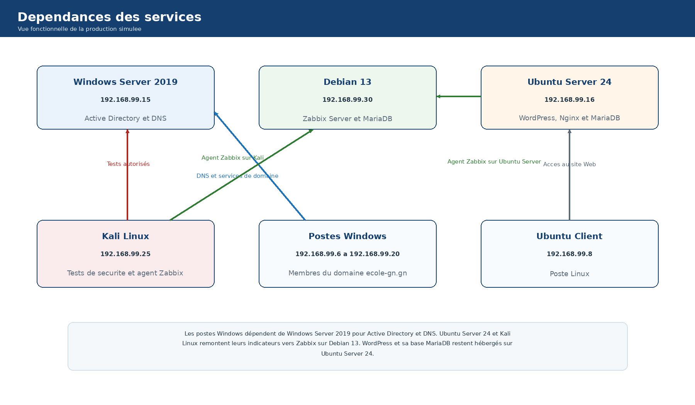

*Figure 2. Dépendances entre les services, les agents Zabbix et le serveur de supervision.*

| **Cible**        | **Agent**     | **Éléments suivis**                                               | **Serveur collecteur** |
|------------------|---------------|-------------------------------------------------------------------|------------------------|
| Ubuntu Server 24 | Zabbix Agent  | CPU, mémoire, disque, réseau, Nginx, MariaDB, état du serveur     | Debian 13              |
| Kali Linux       | Zabbix Agent  | CPU, mémoire, disque, réseau, état du poste                       | Debian 13              |
| Debian 13        | Zabbix Server | Serveur de supervision et base MariaDB selon configuration locale | Local                  |

## 6.2 Chemin de supervision

1. Les agents Zabbix collectent les données locales sur les machines supervisées.
2. Les données sont transmises au serveur Zabbix situé sur Debian 13.
3. Zabbix stocke les données dans MariaDB sur le même serveur Debian.
4. Les alertes et tableaux de bord sont produits depuis le serveur Zabbix.

> **Critère de disponibilité**
>
> La supervision n’apporte une valeur opérationnelle que si le serveur Zabbix, sa base MariaDB et le chemin réseau jusqu’aux agents sont disponibles. Le monitoring doit donc être lui-même surveillé.

# 7. Haute disponibilité pfSense

## 7.1 Interfaces de pfSense

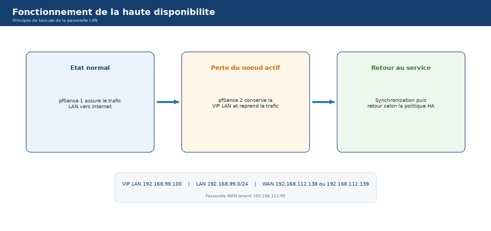

*Figure 3. Principe de bascule de la passerelle virtuelle LAN entre les deux pfSense.*

| **Pare-feu** | **LAN**      | **WAN**         | **Synchronisation** | **Rôle**                  |
|--------------|--------------|-----------------|---------------------|---------------------------|
| pfSense 1    | 192.168.99.1 | 192.168.112.138 | 10.1.10.2           | Nœud actif de référence   |
| pfSense 2    | 192.168.99.2 | 192.168.112.139 | 10.1.10.3           | Nœud secours de référence |

## 7.2 Passerelle virtuelle

Les équipements du LAN utilisent 192.168.99.100 comme passerelle. Cette adresse représente le point d’entrée logique de la paire de pare-feu. En fonctionnement normal, le trafic est traité par le nœud actif. Lorsqu’une bascule est opérée, le nœud de secours reprend la passerelle virtuelle et assure le trafic selon l’état de ses interfaces et de sa configuration.

## 7.3 Réseau de synchronisation

VMnet15 est exclusivement réservé à la communication entre pfSense 1 et pfSense 2. Les adresses sont 10.1.10.2 et 10.1.10.3. Aucun rôle de passerelle n’est associé à ce réseau. La valeur 10.1.10.1 ne fait pas partie de la configuration documentée.

## 7.4 Critères de bascule

- Perte de l’interface WAN du nœud actif.

- Perte de l’interface LAN du nœud actif.

- Arrêt du nœud actif.

- Perte de la connectivité de synchronisation, à traiter séparément car elle ne signifie pas nécessairement une perte de service WAN.

- Retour du nœud initial et synchronisation avant remise en service selon la politique HA retenue.

# 8. Politique réseau et sécurité

## 8.1 Politique d’accès Internet

La sortie Internet est contrôlée par la paire pfSense. Les règles appliquées côté LAN distinguent les équipements autorisés à utiliser Internet et une plage réservée qui reste limitée au réseau interne.

| **Source**                       | **Destination**                | **Accès Internet**            | **Accès interne**          |
|----------------------------------|--------------------------------|-------------------------------|----------------------------|
| Adresses LAN hors plage réservée | Internet via pfSense           | Autorisé selon règles pfSense | Autorisé selon règles LAN  |
| 192.168.99.110 à 192.168.99.120  | Internet                       | Interdit                      | Autorisé                   |
| pfSense vers réseau WAN          | 192.168.112.0/24 et passerelle | Requis pour la sortie         | Non applicable             |
| VMnet15                          | pfSense 1 et pfSense 2         | Aucune sortie attendue        | Synchronisation uniquement |

## 8.1.1 NAT sortante

Mode Hybrid Outbound NAT. Une règle manuelle traduit les sous-réseaux LAN (« LAN subnets ») vers la VIP CARP WAN 192.168.112.99 sur l’interface WAN. Toute la paire sort ainsi sous une adresse unique, quel que soit le nœud actif, ce qui permet aux connexions en cours de survivre à une bascule.

## 8.2 Position de Kali Linux

Kali Linux est raccordé au LAN interne et porte l’adresse 192.168.99.25. Il est utilisé comme poste d’évaluation de la surface d’exposition interne, de la segmentation logique et des règles de filtrage. Son usage doit rester limité aux tests autorisés sur les équipements de l’environnement.

## 8.3 Limite de segmentation actuelle

Le réseau utilisateur et serveur est actuellement regroupé dans 192.168.99.0/24. Le filtrage des sorties Internet apporte une séparation fonctionnelle, mais il ne constitue pas une segmentation par VLAN. Dans une architecture d’entreprise durcie, le serveur WordPress serait isolé dans une zone applicative ou une DMZ, et les flux vers Active Directory et MariaDB seraient explicitement autorisés.

# 9. Flux applicatifs et dépendances

| **Origine**      | **Destination**          | **Usage**                             | **Réseau** | **Contrôle attendu**                         |
|------------------|--------------------------|---------------------------------------|------------|----------------------------------------------|
| Postes Windows   | 192.168.99.15            | DNS et services de domaine            | LAN        | Autoriser les flux AD et DNS requis          |
| Postes Windows   | 192.168.99.100           | Accès inter réseau et Internet        | LAN        | Filtrer sur pfSense                          |
| Ubuntu Server 24 | 192.168.99.30            | Supervision Zabbix                    | LAN        | Autoriser agent vers Zabbix                  |
| Kali Linux       | 192.168.99.30            | Supervision Zabbix                    | LAN        | Autoriser agent vers Zabbix                  |
| Zabbix Server    | Ubuntu Server 24 et Kali | Collecte selon mode de fonctionnement | LAN        | Autoriser les ports Zabbix nécessaires       |
| WordPress        | MariaDB locale           | Accès base applicative                | Local      | Ne pas exposer la base au LAN si inutile     |
| pfSense 1        | pfSense 2                | Synchronisation HA                    | VMnet15    | Autoriser uniquement les flux HA nécessaires |
| pfSense actif    | 192.168.112.2            | Routage vers le réseau amont depuis la VIP WAN 192.168.112.99 | WAN        | Autoriser la sortie du nœud actif            |

# 10. Exploitation et procédures

## 10.1 Contrôle quotidien

- Vérifier l’état de la paire pfSense et l’état de la passerelle 192.168.99.100.

- Vérifier la connectivité Internet depuis un poste autorisé.

- Vérifier qu’une adresse comprise entre 192.168.99.110 et 192.168.99.120 ne sort pas sur Internet.

- Vérifier le statut du serveur Zabbix et la fraîcheur des données reçues des agents.

- Vérifier la résolution DNS interne depuis un poste Windows.

- Vérifier l’accès au site WordPress et l’état de Nginx et MariaDB.

## 10.2 Incident de connectivité Internet

1. Tester la passerelle 192.168.99.100 depuis un poste du LAN.
2. Vérifier quel pfSense porte la passerelle virtuelle.
3. Tester la communication entre le nœud actif et la passerelle NAT VMware 192.168.112.2, et vérifier que le nœud actif porte la VIP WAN 192.168.112.99.
4. Contrôler l’interface WAN et la route par défaut du nœud actif.
5. Vérifier la présence du nœud de secours et son état de synchronisation.
6. En cas de panne du nœud actif, déclencher ou constater la bascule puis refaire les tests fonctionnels.

## 10.3 Incident DNS et domaine

1. Depuis un poste Windows, tester la connectivité vers 192.168.99.15.
2. Tester la résolution du nom du domaine ecole-gn.gn.
3. Vérifier le service DNS et les services Active Directory sur Windows Server 2019.
4. Contrôler la configuration DNS du poste et confirmer la présence de 192.168.99.15.
5. Revalider l’ouverture de session sur le domaine après correction.

## 10.4 Incident de supervision

1. Depuis Debian 13, vérifier le service Zabbix Server et la base MariaDB.
2. Vérifier la connectivité vers les adresses des agents.
3. Depuis Ubuntu Server 24 et Kali, vérifier le service et la configuration de l’agent Zabbix.
4. Confirmer que les dernières données sont reçues par Zabbix.
5. Rejouer un contrôle de service Nginx et MariaDB sur Ubuntu Server 24.

# 11. Plan de validation

Le plan suivant transforme l’architecture en critères de recette observables. Chaque test peut être exécuté après une modification réseau, système ou sécurité.

| ID | Test | Action | Résultat attendu | Résultat obtenu (16/10/2026) |
|---|---|---|---|---|
| NET 01 | Adressage LAN | Tester la passerelle depuis une VM | 192.168.99.100 répond | Réussi |
| NET 02 | Sortie Internet autorisée | Depuis un poste hors plage réservée, tester une destination Internet | Accès fonctionnel | Réussi : ping 8.8.8.8 depuis 192.168.99.8, navigation web depuis 192.168.99.15 |
| NET 03 | Sortie Internet interdite | Depuis une adresse 192.168.99.110 à .120, tester une destination Internet | Accès bloqué | Réussi, capture à ajouter |
| NET 04 | Réseau interne | Depuis une adresse de la plage réservée, joindre une ressource LAN autorisée | Communication interne fonctionnelle | Réussi, capture à ajouter |
| HA 01 | Reprise par le nœud de secours | pfSense 1 arrêté, seul pfSense 2 en service | La VIP 192.168.99.100 reste disponible | Réussi : pfSense 2 assure seul la sortie Internet (ping 8.8.8.8 sans perte, 28 à 39 ms) |
| HA 01b | Bascule à chaud | Ping continu depuis un poste, puis arrêt brutal de pfSense 1 en cours de trafic | Nombre de paquets perdus mesuré | Réussi : environ 3 s de coupure (3 paquets perdus sous Linux, 1 délai d’attente sous Windows) |
| HA 03 | Double panne | Arrêt des deux pfSense pendant un ping continu, puis redémarrage d’un nœud | Coupure totale, reprise dès qu’un nœud revient | Conforme |
| HA 02 | Retour du nœud | Redémarrer le nœud initial et contrôler Status > CARP | pfSense 1 redevient MASTER, pfSense 2 repasse BACKUP | Réussi |
| HA 04 | Synchronisation des états | Contrôler les State Creator Host IDs dans Status > CARP | Les deux identifiants visibles sur chaque nœud | Réussi après correction de l’adresse du pair pfsync (voir 11.3) |
| HA 05 | Survie d’une session TCP | Téléchargement HTTP continu (curl limité à 200 ko/s), puis arrêt de pfSense 1 | La connexion n’est pas interrompue | Réussi : aucune interruption, débit moyen constant |
| AD 01 | DNS interne | Résoudre le domaine depuis un poste Windows | Réponse DNS depuis 192.168.99.15 | Capture à ajouter |
| AD 02 | Domaine | Ouvrir une session avec un compte du domaine | Authentification fonctionnelle | Capture à ajouter |
| WEB 01 | WordPress | Accéder au site | Page applicative disponible | Capture à ajouter |
| WEB 02 | Nginx | Vérifier le service | Service actif et accessible | Capture à ajouter |
| WEB 03 | MariaDB | Vérifier la base WordPress | Base accessible par l’application | Capture à ajouter |
| MON 01 | Zabbix | Vérifier les hôtes et dernières données | Données fraîches et sans erreur | Capture à ajouter |
| SEC 01 | Kali | Exécuter un test autorisé sur une cible interne | Résultats exploitables et traçables | À réaliser |

## 11.1 Campagne de tests du 16 octobre 2026

**Situation de référence : les deux pfSense arrêtés.** Aucune machine du LAN ne sort sur Internet. Depuis Ubuntu Client, le ping de 8.8.8.8 renvoie « Destination Host Unreachable » ; sur Windows Server 2019, l’icône réseau signale l’absence d’accès Internet.

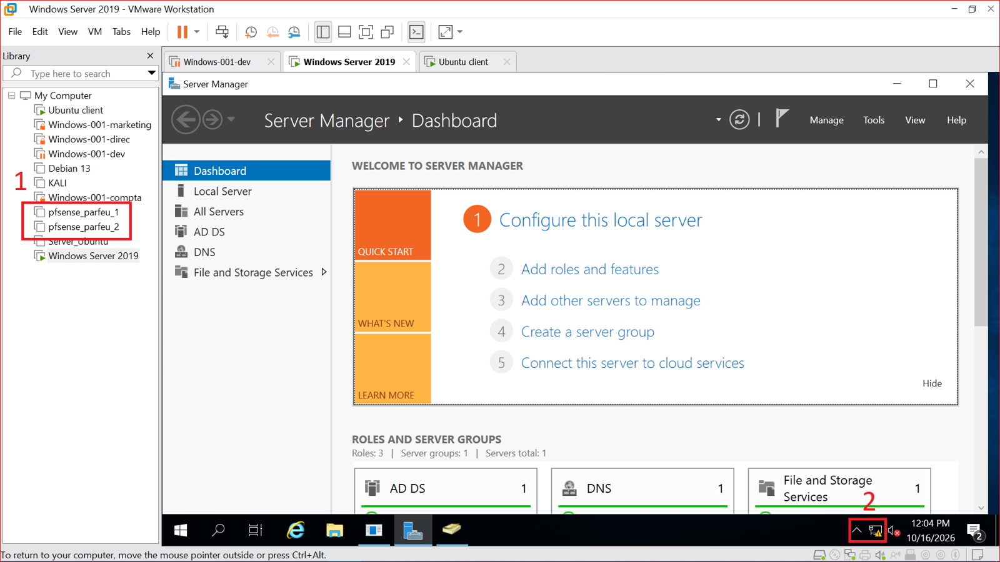

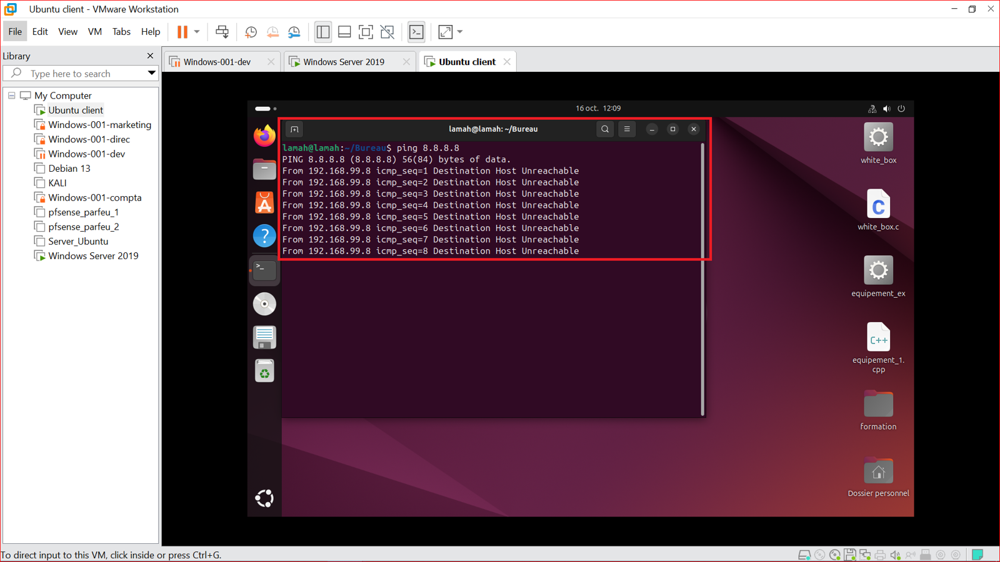

**Test HA 01 : pfSense 1 arrêté, pfSense 2 seul en service.** pfSense 2 (version 2.7.2-RELEASE) porte ses trois interfaces : WAN em0 en 192.168.112.139/24, LAN em1 en 192.168.99.2/24, SYNC em2 en 10.1.10.3/24.

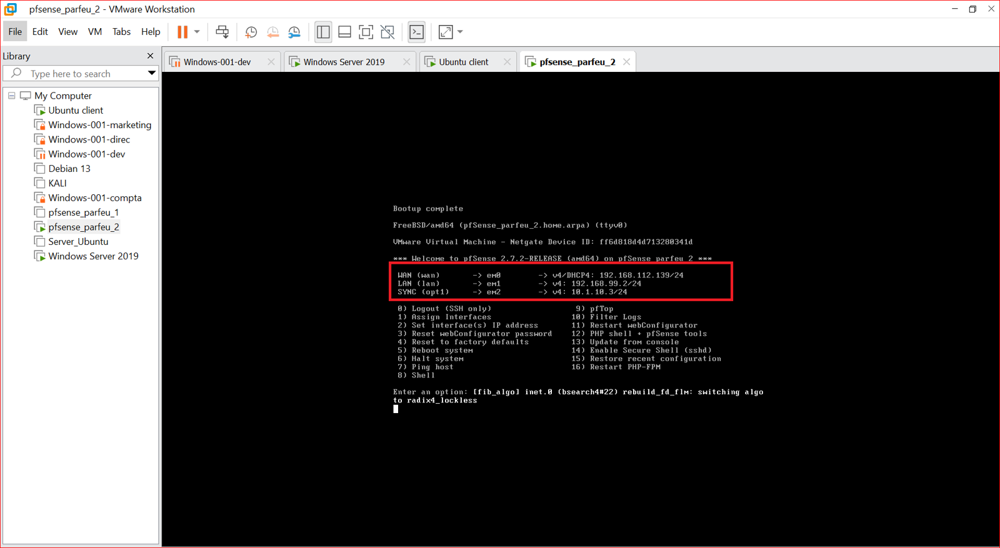

Les machines du LAN, qui utilisent toujours la passerelle 192.168.99.100, retrouvent l’accès Internet : ping de 8.8.8.8 sans perte depuis Ubuntu Client, navigation web depuis Windows Server 2019.

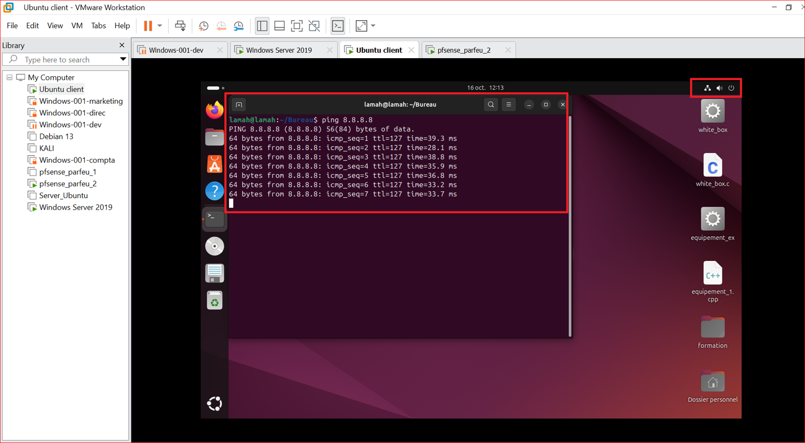

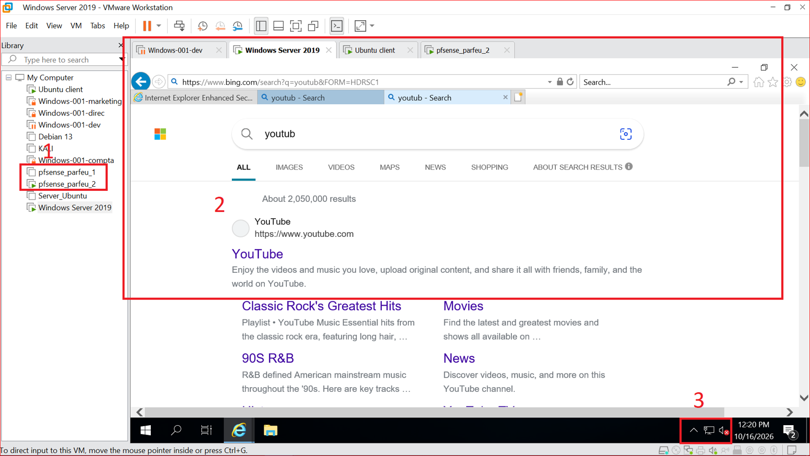

**Conclusion.** Le nœud de secours prend en charge la passerelle virtuelle et la sortie Internet sans modification sur les postes. La bascule à chaud est détaillée en 11.2.

## 11.2 Bascule à chaud du 16 octobre 2026

**Méthode.** Les deux pfSense sont en service. Un ping continu vers 8.8.8.8 est lancé depuis Ubuntu Client (192.168.99.8) et depuis le poste Windows Direction. pfSense 1 est ensuite arrêté brutalement (Power Off dans VMware) pendant que le trafic passe.

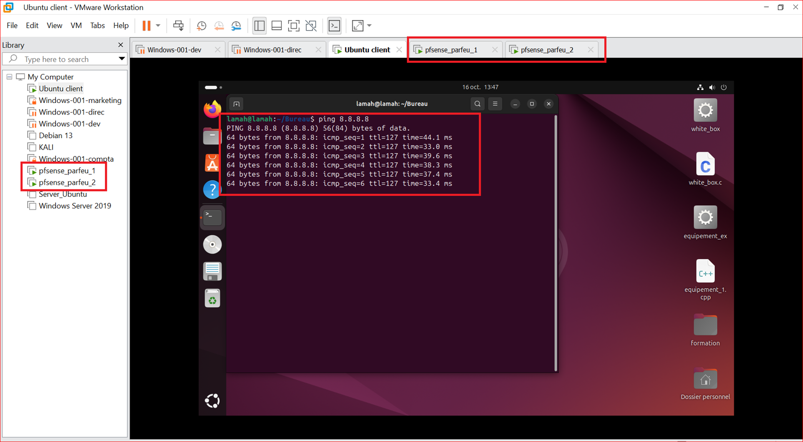

**Résultat sous Linux.** La réponse icmp_seq=54 met 452 ms, puis la suivante affichée est icmp_seq=58 : les requêtes 55, 56 et 57 sont restées sans réponse. Sous Linux, ping n’affiche pas les paquets perdus, il faut les repérer aux numéros de séquence manquants. Avec un ping par seconde, la coupure est donc d’environ 3 secondes. Le trafic repart ensuite normalement par pfSense 2.

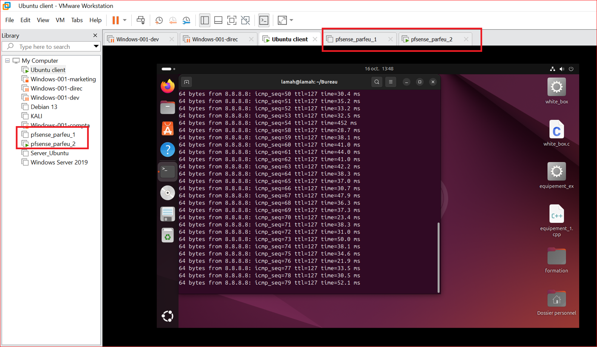

**Résultat sous Windows.** Un seul « Request timed out » apparaît pendant la bascule, puis les réponses reprennent.

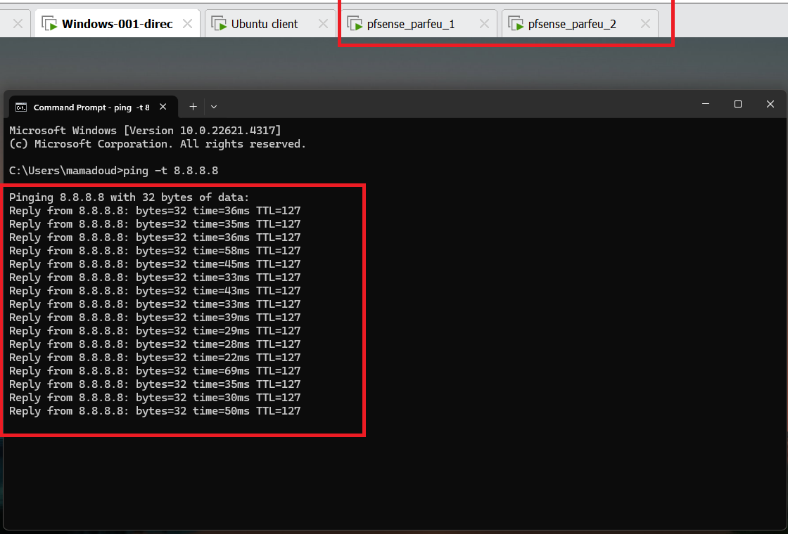

**Double panne (HA 03).** Quand pfSense 2 est arrêté à son tour, plus aucune réponse ne revient, puis le poste signale « Destination Host Unreachable » : plus personne ne porte la passerelle 192.168.99.100. Le trafic reprend dès qu’un des deux nœuds redémarre.

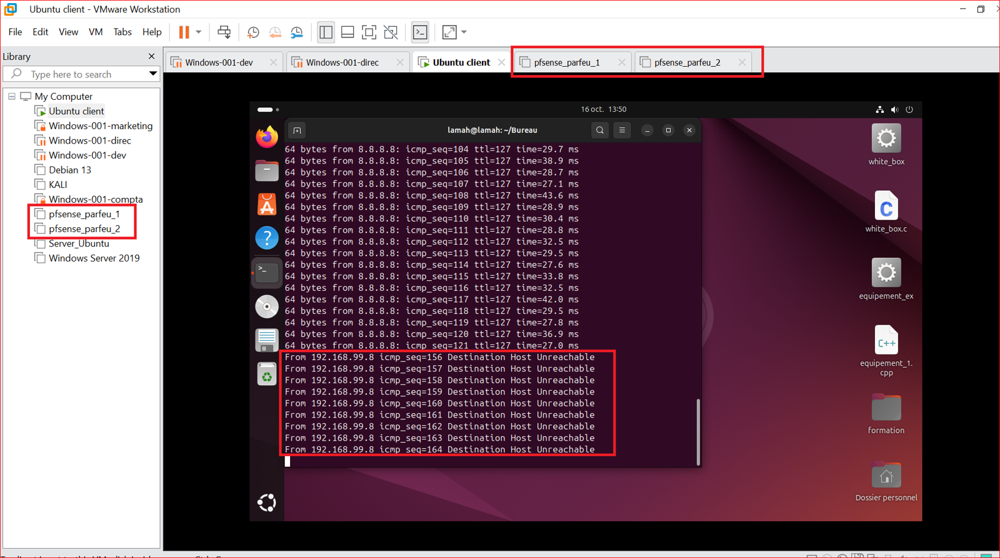

**Conclusion.** La bascule entre les deux pare-feu coûte environ 3 secondes de coupure, sans aucune action sur les postes. La redondance protège contre la perte d’un nœud, pas contre la perte des deux.

## 11.3 Statut CARP et retour du nœud principal

**Fonctionnement normal.** pfSense 1 est MASTER sur les deux VIP (WAN@1 192.168.112.99 et LAN@2 192.168.99.100), pfSense 2 est BACKUP.

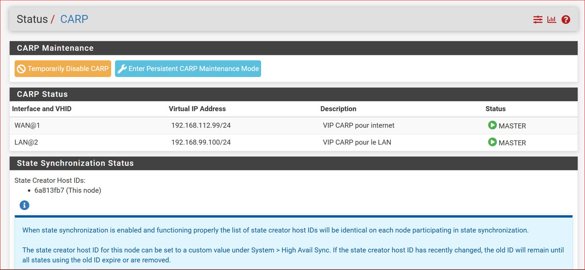

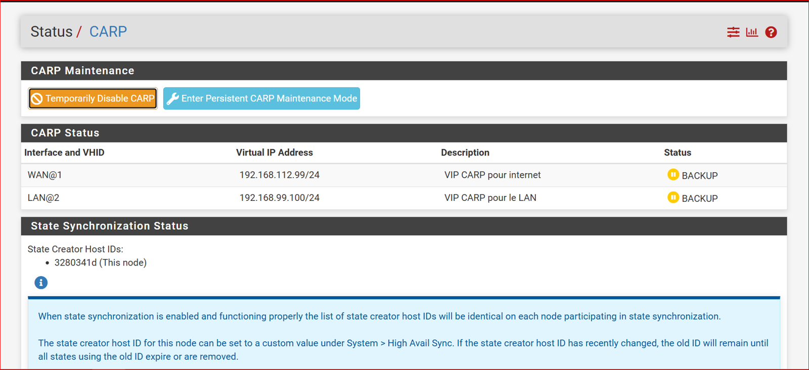

**pfSense 1 arrêté.** pfSense 2 passe MASTER sur les deux VIP.

**pfSense 1 redémarré (HA 02).** pfSense 1 reprend le rôle de maître et pfSense 2 repasse BACKUP sans intervention.

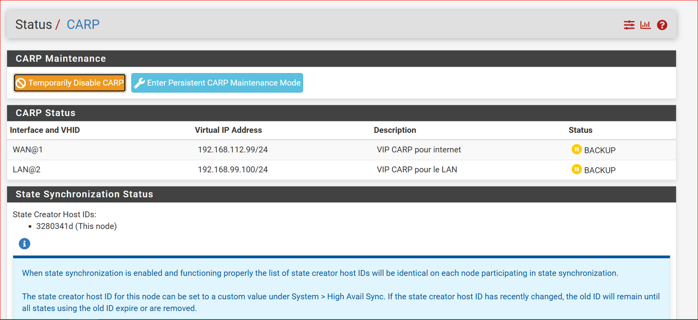

**Mesure de la coupure.** Avec `ping -O`, les requêtes perdues sont affichées : 3 requêtes sans réponse (icmp_seq 15 à 17) lors de la bascule, soit environ 3 secondes. Sur une série complète de 270 requêtes, 3 sont perdues (1,1 %).

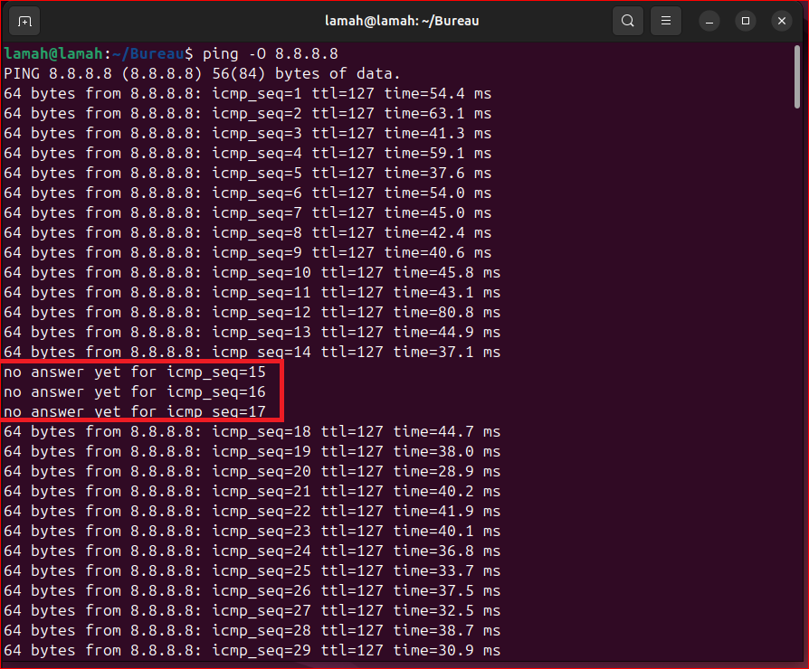

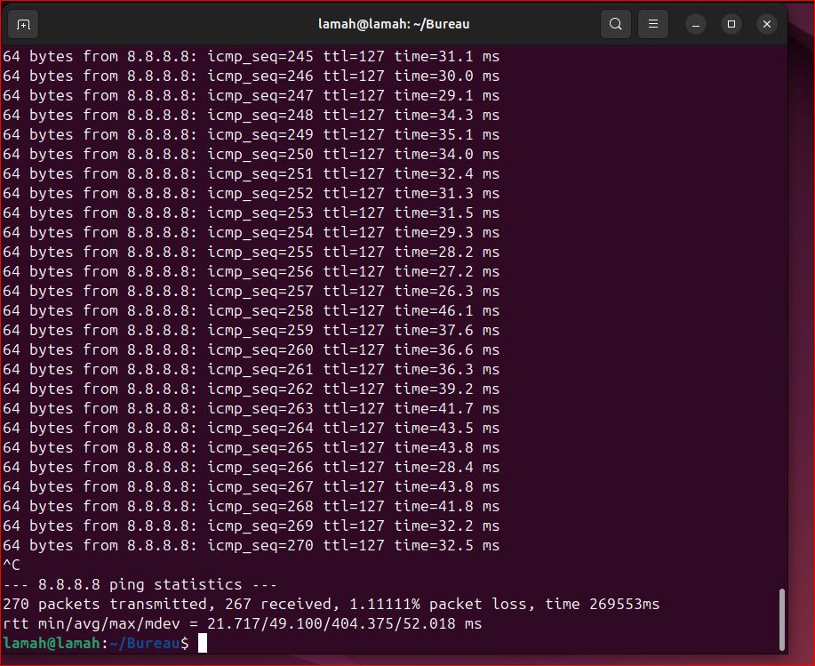

**Constat initial : synchronisation des états non fonctionnelle (HA 04).** Dans la section State Synchronization Status, chaque nœud n’affiche que son propre identifiant (6a813fb7 sur pfSense 1, 3280341d sur pfSense 2). Selon pfSense, les deux identifiants doivent apparaître sur chaque nœud quand la synchronisation des états (pfsync) fonctionne. Conséquence : lors d’une bascule, les connexions en cours ne sont pas reprises par le nœud de secours. Le ping repart car chaque requête est indépendante, mais une session TCP (SSH, RDP, téléchargement) serait coupée. La recherche de la cause et la correction sont décrites ci-dessous.

**Première action corrective.** Une règle Pass (IPv4, tout protocole, source SYNC subnets, destination any) a été ajoutée sur l’interface SYNC. Après application, chaque nœud n’affiche toujours que son propre identifiant : la règle était nécessaire mais ne suffisait pas.

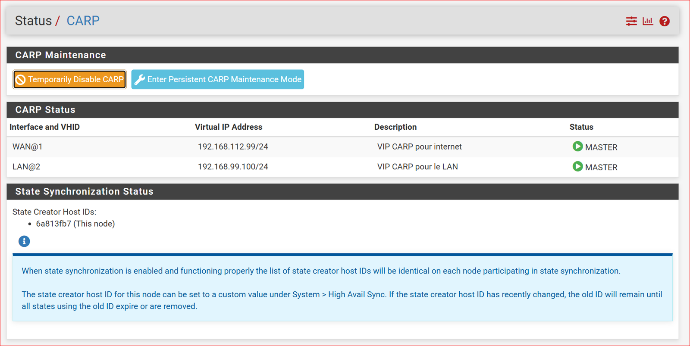

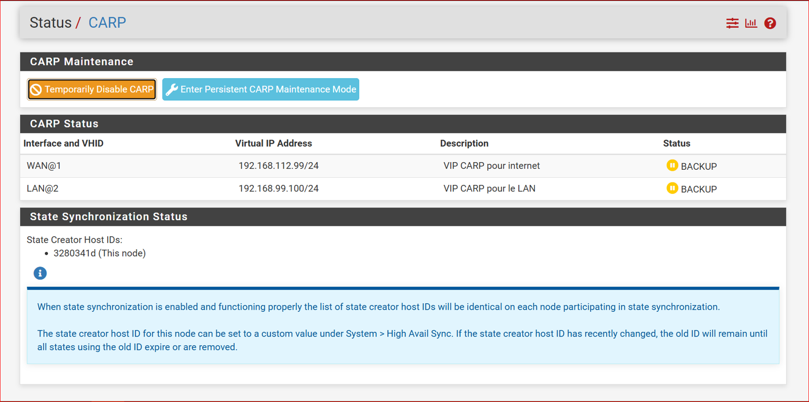

**Cause trouvée.** Dans System > High Avail Sync, le champ pfsync Synchronize Peer IP contenait 192.168.99.1, l’adresse LAN de pfSense 1. Les états étaient donc envoyés vers une adresse hors du réseau de synchronisation et n’atteignaient jamais l’autre nœud.

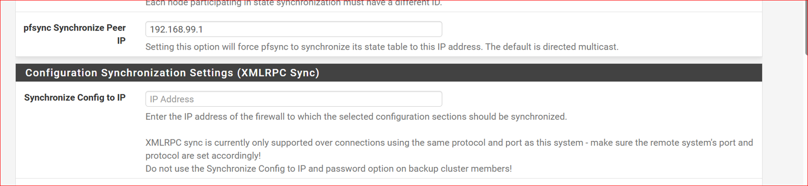

**Correction.** Adresse du pair positionnée sur le réseau SYNC : 10.1.10.3 sur pfSense 1, 10.1.10.2 sur pfSense 2, avec Synchronize states coché et l’interface SYNC sélectionnée sur les deux nœuds. La synchronisation de configuration (XMLRPC) n’est configurée que sur le maître, conformément à l’avertissement de pfSense.

**Résultat (HA 04 réussi).** Chaque nœud affiche désormais les deux identifiants, 6a813fb7 et 3280341d : les tables d’états sont partagées.

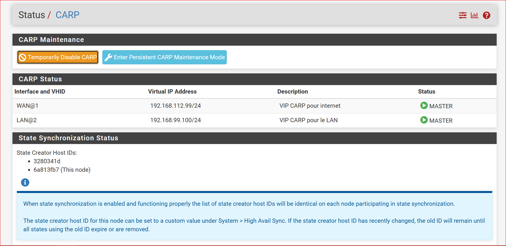

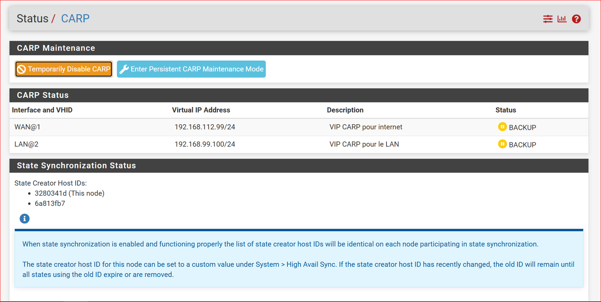

## 11.4 Passerelle WAN amont

La page System > Routing > Gateways montre une seule passerelle, WAN_DHCP, à l’adresse 192.168.112.2 (passerelle du NAT VMware), utilisée comme passerelle par défaut. L’adresse 192.168.112.99 est la VIP CARP WAN et non la passerelle amont : le dossier et les schémas ont été corrigés en conséquence.

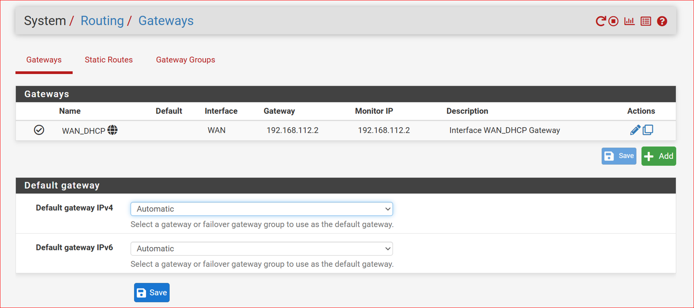

## 11.5 Survie d’une session TCP pendant la bascule (HA 05)

**Pourquoi ce test.** Un ping prouve que la passerelle bascule, pas que les connexions en cours survivent. Pour cela, il faut une seule connexion TCP longue qui ne se relance pas d’elle-même. Une mise à jour apt ne convient pas : elle ouvre une nouvelle connexion par fichier et réessaie en cas d’échec.

**Méthode.** Depuis Ubuntu Client, téléchargement d’un fichier de 1 Go limité à 200 ko/s pour qu’il dure plusieurs minutes :

`curl --limit-rate 200k -o /dev/null http://speedtest.tele2.net/1GB.zip`

pfSense 1 est arrêté brutalement pendant le transfert.

**Résultat.**

| Heure | pfSense 1 | Temps écoulé | Reçu | Débit moyen |
|---|---|---|---|---|
| 16:25 | En service | 0:15 | 3,1 Mo | 199 ko/s |
| 16:26 | Arrêté | 1:38 | 19,6 Mo | 203 ko/s |
| 16:27 | Arrêté | 2:29 | 29,6 Mo | 202 ko/s |

Le compteur de temps est continu : c’est la même connexion du début à la fin. Le débit moyen ne baisse pas, la coupure n’est donc pas visible à l’échelle du transfert. La session TCP a été reprise par pfSense 2 grâce à la table d’états synchronisée par pfsync.

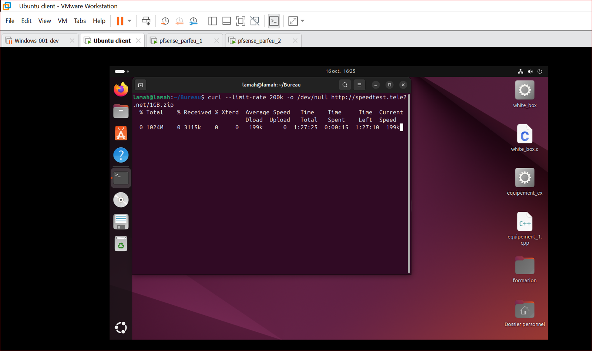

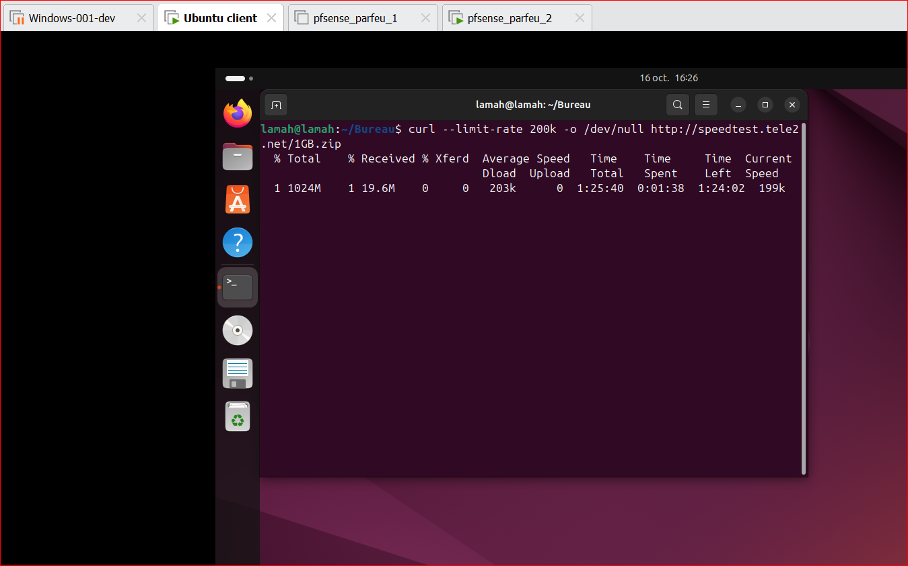

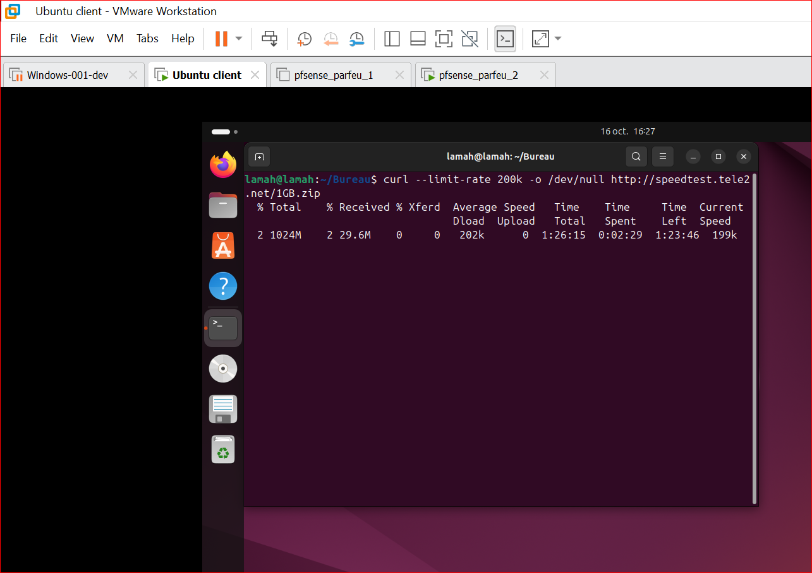

## 11.6 Correction de la NAT sortante

Avant correction, la règle de NAT sortante traduisait vers « WAN address », c’est-à-dire l’adresse propre de chaque nœud (192.168.112.138 ou 192.168.112.139). Lors d’une bascule, l’adresse de sortie changeait et les connexions en cours étaient perdues pour le serveur distant, même avec pfsync. La règle traduit désormais vers la VIP WAN 192.168.112.99, partagée par les deux nœuds : c’est cette correction, avec pfsync, qui rend le test HA 05 possible.

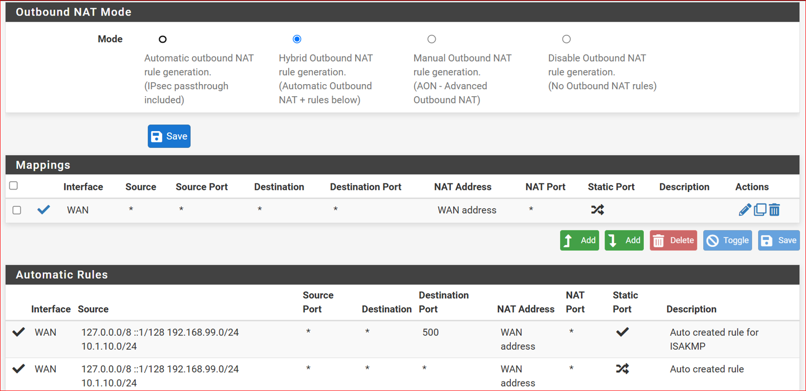

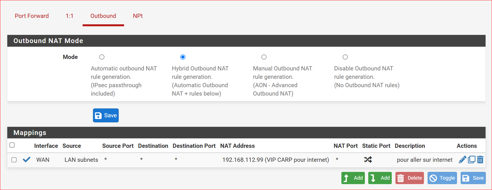

# 12. Continuité, sauvegarde et restauration

Les mécanismes de sauvegarde ne sont pas détaillés dans les informations d’entrée. Pour une exploitation réelle, ils doivent être documentés avec une politique de rétention, une fréquence, une destination hors hôte et un test périodique de restauration.

## 12.1 Jeux de données à protéger

| **Objet**              | **Contenu**                             | **Criticité** | **Contrôle recommandé**                                           |
|------------------------|-----------------------------------------|---------------|-------------------------------------------------------------------|
| Windows Server 2019    | Base AD et configuration DNS            | Très haute    | Sauvegarde système et état du système                             |
| Debian 13              | Configuration Zabbix et MariaDB         | Haute         | Sauvegarde de la base et du serveur                               |
| Ubuntu Server 24       | WordPress, MariaDB, configuration Nginx | Très haute    | Sauvegarde fichiers, base et configuration                        |
| pfSense                | Configuration et état de la paire       | Très haute    | Export de configuration et archivage des deux nœuds               |
| Postes Windows et Kali | Données de travail et configurations    | Selon usage   | Snapshot uniquement pour le lab, sauvegarde pour données durables |

## 12.2 Reprise après incident

La reprise commence par la restauration de la connectivité réseau, puis du socle AD et DNS, ensuite de la supervision et enfin des services applicatifs. Le service WordPress dépend du fonctionnement de son serveur Ubuntu et de sa base MariaDB. Le domaine dépend de Windows Server 2019. La supervision dépend de Debian 13 et de sa base MariaDB.

# 13. Risques et évolutions

| **Sujet**    | **Constat actuel**                   | **Impact**                                                | **Évolution proposée**                                                   |
|--------------|--------------------------------------|-----------------------------------------------------------|--------------------------------------------------------------------------|
| Segmentation | Un seul LAN 192.168.99.0/24          | Mouvement latéral facilité en cas de compromission        | Créer des VLAN serveurs, utilisateurs, administration et DMZ             |
| Web          | WordPress situé sur le LAN principal | Exposition applicative sur le même segment que les postes | Isoler la plateforme Web et limiter les flux vers AD et MariaDB          |
| Supervision  | Zabbix est concentré sur Debian 13   | Perte de visibilité en cas de panne Debian                | Ajouter une stratégie de sauvegarde et une supervision du serveur Zabbix |
| DNS          | Un seul serveur DNS                  | Point unique de panne pour le domaine                     | Ajouter un second DNS intégré AD                                         |
| WAN          | Deux WAN sur le même réseau amont    | Une panne du réseau amont peut affecter les deux pare-feu | Ajouter un second accès amont indépendant si nécessaire                  |
| Sauvegarde   | Politique non détaillée              | Risque de perte de configuration ou de données            | Définir RPO, RTO, rétention et tests de restauration                     |

## 13.1 Évolutions prioritaires pour un SI d’entreprise

- Séparer les postes, les serveurs, l’administration, la supervision et la DMZ par VLAN et règles de filtrage inter zones.

- Ajouter un second contrôleur de domaine et DNS.

- Mettre en place une sauvegarde centralisée des VM, des configurations pfSense et des bases de données.

- Déployer une gestion centralisée des journaux et des alertes de sécurité.

- Documenter précisément les ports applicatifs autorisés et appliquer une politique de refus par défaut.

- Formaliser les procédures d’intervention, de changement et de retour arrière.

# 14. Annexes

## 14.1 Référentiel des valeurs de configuration

| **Paramètre**             | **Valeur de référence**         | **Commentaire**                               |
|---------------------------|---------------------------------|-----------------------------------------------|
| Domaine Active Directory  | ecole-gn.gn                     | Domaine utilisé par les quatre postes Windows |
| LAN                       | 192.168.99.0/24                 | VMnet14                                       |
| VIP LAN                   | 192.168.99.100                  | Passerelle logique de la paire pfSense        |
| WAN pfSense 1             | 192.168.112.138                 | Réseau amont                                  |
| WAN pfSense 2             | 192.168.112.139/24              | Obtenue par DHCP sur le NAT VMware            |
| VIP WAN                   | 192.168.112.99/24               | VIP CARP VHID 1, adresse de sortie Internet   |
| VIP LAN (VHID)            | 192.168.99.100/24               | VIP CARP VHID 2                               |
| Passerelle WAN amont      | 192.168.112.2                   | Passerelle NAT VMware (WAN_DHCP), passerelle par défaut automatique |
| Synchronisation pfSense 1 | 10.1.10.2/24                    | VMnet15                                       |
| Synchronisation pfSense 2 | 10.1.10.3/24                    | VMnet15                                       |
| Version pfSense           | 2.7.2-RELEASE (amd64)           | Relevée sur la console de pfSense 2           |
| Interfaces pfSense        | em0 WAN, em1 LAN, em2 SYNC      | Affectation identique sur les deux nœuds à confirmer |
| NAT sortante              | LAN subnets vers 192.168.112.99 | Mode Hybrid, adresse de sortie commune aux deux nœuds |
| Plage sans Internet       | 192.168.99.110 à 192.168.99.120 | Communication interne conservée               |
| DNS AD                    | 192.168.99.15                   | Windows Server 2019                           |
| Zabbix Server             | 192.168.99.30                   | Debian 13                                     |
| WordPress                 | 192.168.99.16                   | Ubuntu Server 24                              |
| Kali                      | 192.168.99.25                   | Tests de sécurité                             |

## 14.2 Informations à compléter avant une mise en production réelle

- Paramètres exacts du mode HA (CARP, pfsync, synchronisation de configuration).

- Nom exact des interfaces et règles de filtrage pfSense.

- Ports autorisés pour DNS, Active Directory, Zabbix, Nginx et administration.

- FQDN et URL du site WordPress.

- Version exacte de Zabbix et MariaDB.

- Politique de sauvegarde, rétention, RPO et RTO.

- Politique NTP et source de temps.

- Méthode d’accès administrateur, comptes de secours et stockage sécurisé des secrets.
